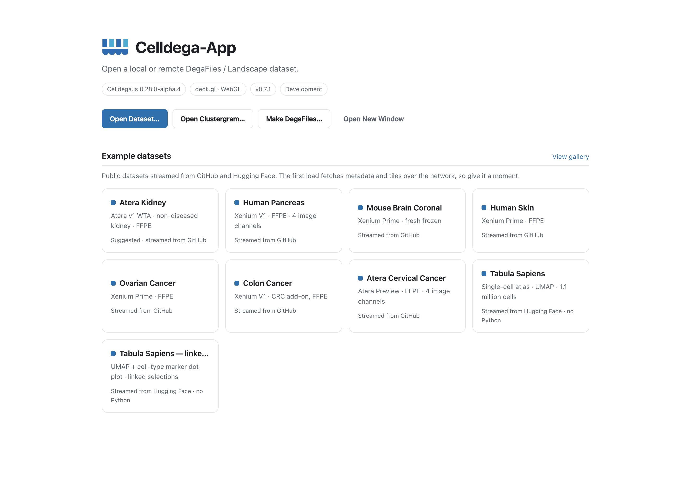
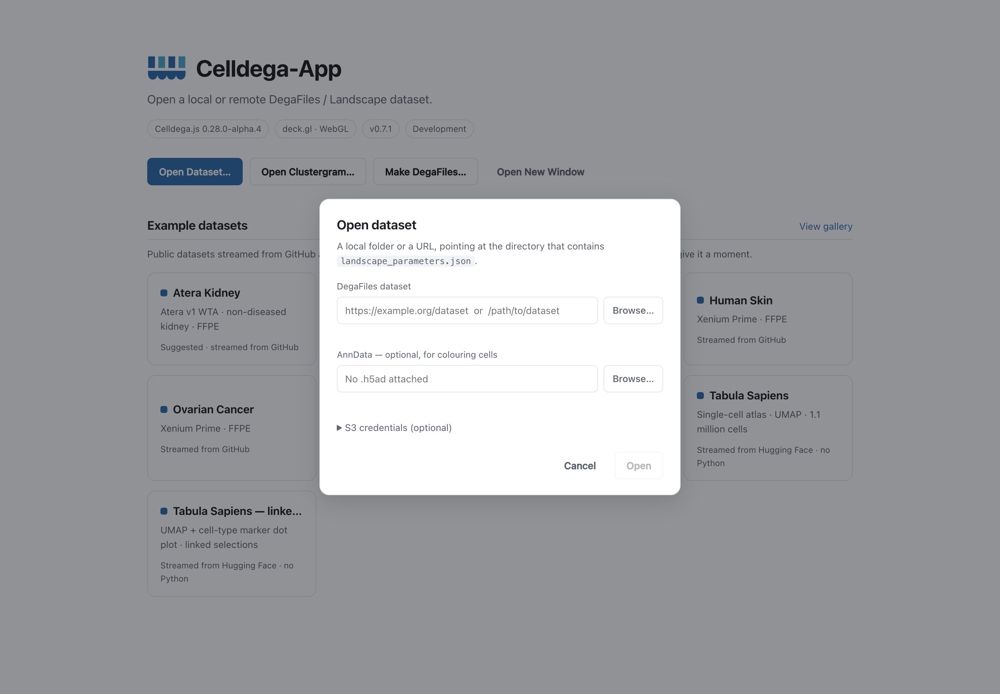
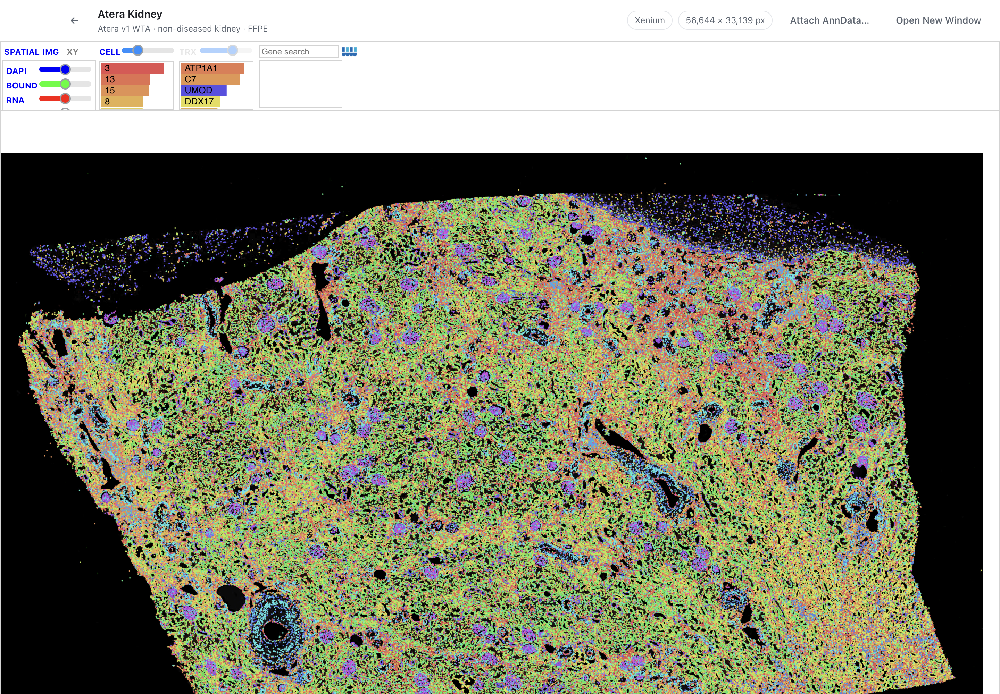
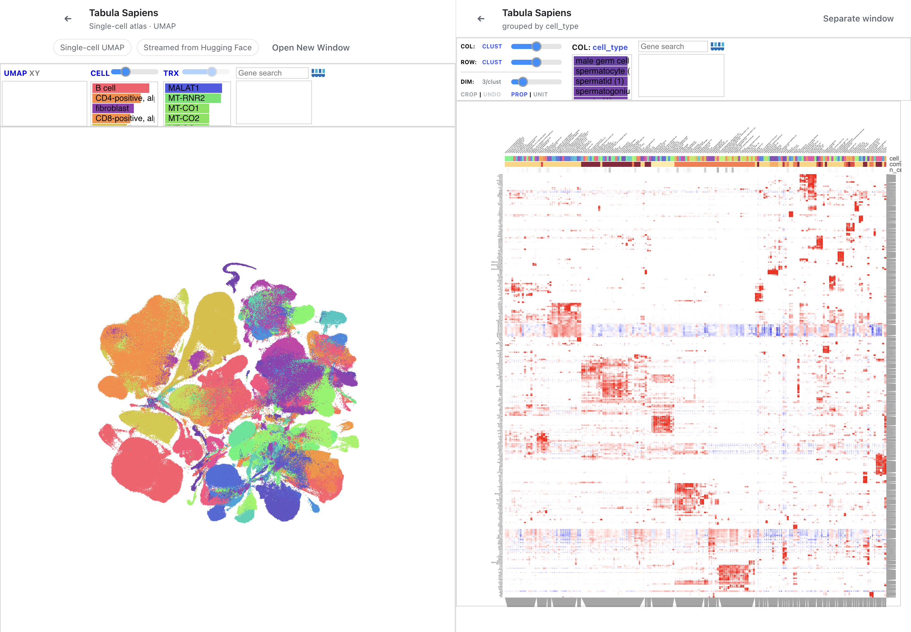
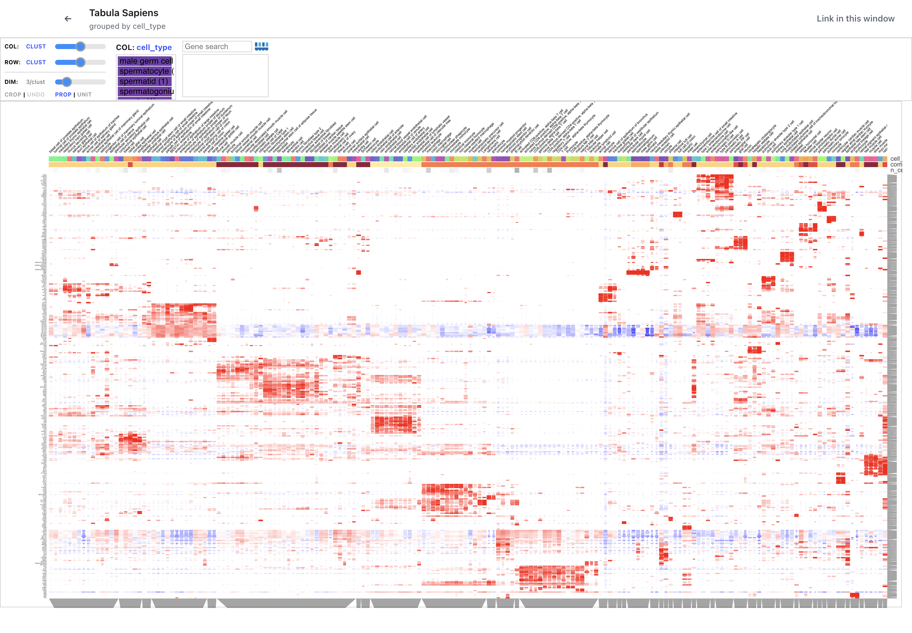
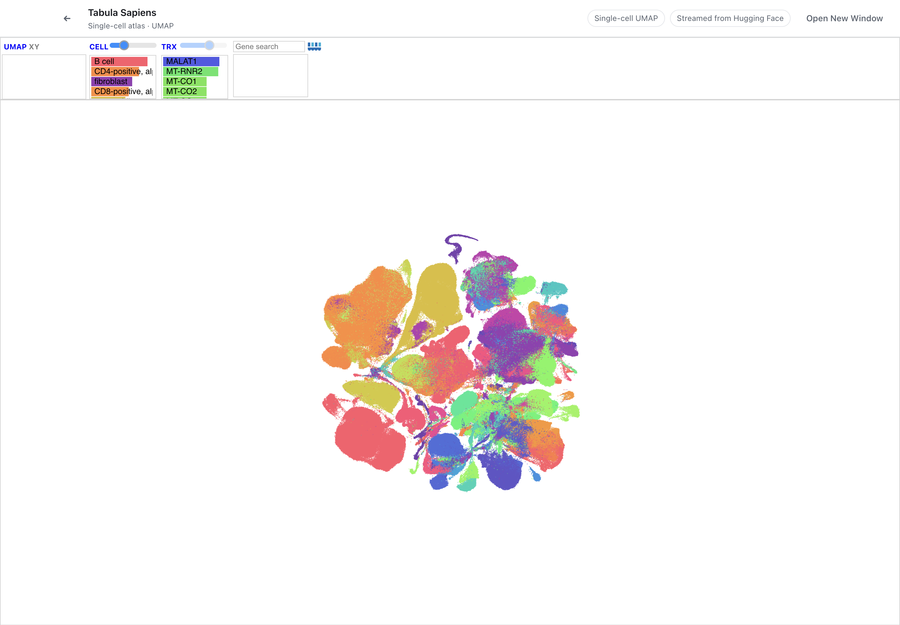

# App screenshots

Reference captures of **Celldega-App 0.7.1** with **Celldega.js 0.28.0-alpha.4**,
taken on macOS on **2026-11-03**. These are screenshots of the running app,
using a clean development profile and public gallery data. They show the app's
content area without desktop or operating-system window decorations.

Each capture uses a 1440 × 1000 viewport. The PNGs retain the display's native
2× resolution (2880 × 2000). [manifest.json](manifest.json) records the capture
time, versions, source revision, descriptions, and image dimensions.

| File | What it shows |
| --- | --- |
| [gallery.png](gallery.png) | Start screen, actions, and example dataset order |
| [open-dataset.png](open-dataset.png) | Local/remote dataset form and AnnData attachment |
| [atera-kidney-landscape.png](atera-kidney-landscape.png) | Spatial Landscape with cell and gene controls |
| [tabula-sapiens-linked.png](tabula-sapiens-linked.png) | UMAP and marker Clustergram in one window |
| [tabula-sapiens-clustergram.png](tabula-sapiens-clustergram.png) | Clustergram opened in a separate window |
| [tabula-sapiens-umap.png](tabula-sapiens-umap.png) | Corresponding UMAP kept in its own window |

## Gallery

The start screen puts Atera Kidney first and the Tabula Sapiens examples last.
The **Development** badge identifies this source run.



## Open a dataset

The form accepts a local DegaFiles folder or remote URL and an optional AnnData
file. The capture uses empty fields, with no local paths or credentials.



## Atera Kidney Landscape

The first gallery example displays kidney cells in their spatial context, with
controls for image channels, cell categories, and genes.



## Linked Tabula Sapiens views

The atlas UMAP and cell-type marker Clustergram share one window. Selecting a
gene or cell-type column in the Clustergram drives the UMAP.



## Separate windows

Using **Separate window** gives the Clustergram more space while keeping the
corresponding UMAP open and linked by dataset.





## Reuse and refresh

From the repository's root README, reference a capture with a relative link:

```markdown

```

For issues, release notes, or other repositories, use the image's GitHub URL.
Use a commit permalink when a reference must retain this exact capture after
future screenshots are refreshed.

To regenerate the set from the repository root:

```sh
npm ci
npm run screenshots
```

The capture script opens the actual app, waits for the public datasets and
views to load, captures each view, then closes its windows. It creates its own
temporary profile and does not read personal recents or credentials. Python
is not needed. Network access is required; the first atlas load may take a
moment. To write elsewhere:

```sh
npm run screenshots -- --screenshot-output=/path/to/captures
```

The script is [capture_screenshots.cjs](../../scripts/capture_screenshots.cjs).
These documentation images and the capture driver are excluded from installer
packages.

## Data sources

- [Atera Kidney DegaFiles](https://github.com/broadinstitute/Celldega_Atera_v1_WTA_Kidney_non_diseased_FFPE/tree/3a46ab4db67821eef3b8ff8d1c3704fb7b3bb48f),
  used by the Celldega Atera Kidney gallery example.
- [Tabula Sapiens supporting data and attribution](https://huggingface.co/datasets/broadinstitute/Celldega_Supporting_Data/blob/df537e04ad0e51a91f3d68a53b788efb61552913/Tabula_Sapiens/README.md),
  including the atlas, cell-type signatures, and marker Clustergram.

Keep the dataset attribution with screenshots reused outside this repository.
